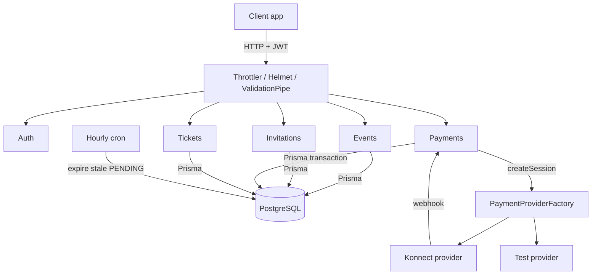
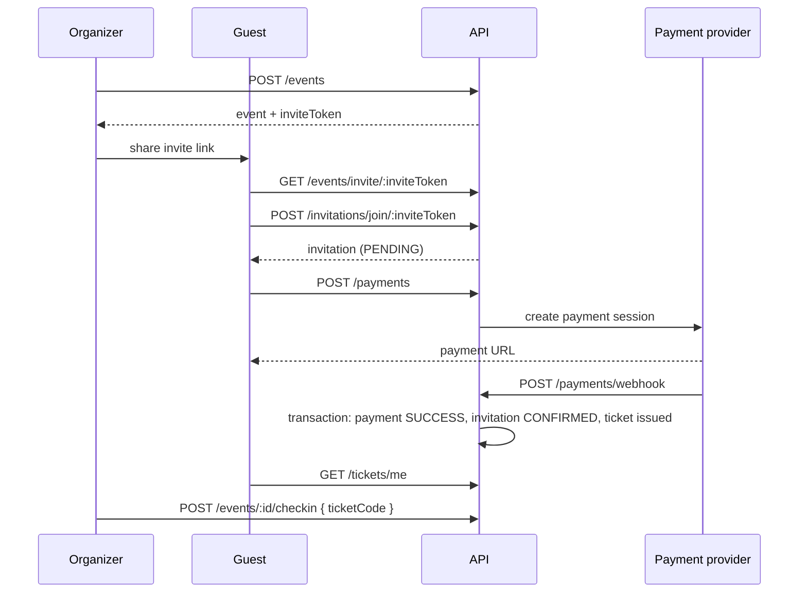

<div align="center">
  <h1>Soirly Backend</h1>
  <p><em>REST API for private paid events: invite link, entry payment, ticket, door check-in.</em></p>

  
  
  
  
  
</div>

Soirly is a solo project of mine. Splitting the cost of a private party usually means a group chat, a screenshot of a bank transfer and an organizer chasing people at the door. This API replaces that with one flow: the organizer creates an event with an entry price, shares an unguessable invite link, each guest joins, pays through a payment gateway, and receives exactly one ticket. At the door the organizer checks the ticket in by code.

The interesting part is the state machine underneath. An invitation moves PENDING, CONFIRMED or DECLINED, a payment moves PENDING, SUCCESS or FAILED, and a ticket exists only as the result of a successful payment, enforced by a unique constraint on `Ticket.paymentId`. Capacity counts both confirmed and pending invitations, and an hourly job releases spots held by guests who never paid.

Payments are behind a provider interface, so a test provider runs locally and the Konnect gateway (Tunisian market) runs in production without touching business logic.

## Features

**Event management** — Create, update and soft-delete events with title, date, location, entry price and optional `maxAttendees`; capacity cannot be lowered below confirmed plus pending invitations.

**Invite links** — Each event has a UUID `inviteToken`; organizers can fetch, toggle and regenerate it. Guests preview an event by token before joining.

**Invitation lifecycle** — Join, decline and list invitations; one invitation per user per event (unique constraint). An hourly cron job (`@nestjs/schedule`) declines PENDING invitations older than 24 hours that have no successful payment.

**Payments** — A payment is created only against a PENDING invitation; the event creator cannot pay for their own event. Retries mark earlier PENDING payments FAILED to keep an audit trail. A configurable platform fee (`APP_FEE_PERCENT`) is recorded per payment.

**Tickets and check-in** — A successful payment issues one ticket with a unique `ticketCode`; organizers check tickets in by code and `checkedInAt` is recorded.

**Access control** — Passport JWT strategy validates the user against the database on every request; role and event-access guards restrict who can read an event (creator, invited users, admins).

**Hardening** — Helmet headers, CORS allow-list, global `ValidationPipe` with whitelist and `forbidNonWhitelisted`, three-window global rate limiting plus stricter limits on signup and signin, Joi validation of environment variables at boot.

**Operations** — `/health`, `/health/ready` and `/health/live` endpoints (database ping, heap check) via Terminus, and structured logging with Winston.

## How It Works





### Key Decisions

- **Payment provider interface**: a `PaymentProvider` interface with a factory that picks Konnect or a test provider (`TEST_PAYMENT_MODE`) over calling the gateway directly from the service, so the full join-pay-ticket flow runs locally with no real money and a second gateway is one class.
- **Invitation as the unit of payment**: payments attach to an invitation (`invitationId` required) over attaching to user and event directly, so every attempt is auditable and a guest cannot pay without having joined.
- **Database-enforced invariants**: unique constraints on `(eventId, userId)` for invitations and tickets and on `paymentId` for tickets over application-level checks alone, so races cannot produce a second ticket.
- **Webhook side effects in one transaction**: payment status, invitation status and ticket creation happen inside a single `prisma.$transaction` over sequential writes, so a crash cannot leave a paid payment without a ticket.
- **Pending invitations hold capacity, then expire**: counting PENDING toward `maxAttendees` over counting only CONFIRMED avoids overselling while guests are paying; the hourly job frees spots that were never paid for.

## Tech Stack

| Technology | Role | Why |
| --- | --- | --- |
| NestJS 11 / TypeScript | API framework | Module boundaries per feature, guards and pipes for cross-cutting security |
| Prisma 6 | ORM and migrations | Schema as source of truth, typed queries, SQL migrations in `prisma/migrations` |
| PostgreSQL | Database | Decimal money columns, unique and partial-lookup indexes |
| Passport JWT, bcrypt | Authentication | — |
| Konnect | Payment gateway | Tunisian-market gateway; abstracted behind `PaymentProvider` |
| Helmet, Throttler, Joi | Hardening and config validation | — |
| `@nestjs/schedule` | Cron jobs | Invitation expiry without a separate worker |
| Jest, Supertest | Tests | — |

## Getting Started

### Prerequisites

- Node.js 20 or newer
- A PostgreSQL database (local or hosted)

### Install

```bash
git clone https://github.com/yassine-krichen/soirly-private-event-ticketing-backend.git
cd soirly-private-event-ticketing-backend
npm install
```

### Configure

Create `.env` from the table below, then apply migrations.

```bash
npx prisma migrate deploy
```

### Run

```bash
npm run start:dev      # watch mode
npm run build && npm run start:prod
```

The server listens on `PORT` (default 3000).

### Test

```bash
npm test
npm run test:e2e
```

## Configuration

| Variable | Required | Default | Description |
| --- | --- | --- | --- |
| `DATABASE_URL` | Yes | — | PostgreSQL connection string |
| `JWT_SECRET` | Yes | — | JWT signing secret, minimum 32 characters |
| `JWT_EXPIRES_IN` | No | `7d` | Token lifetime |
| `GOOGLE_CLIENT_ID` | Yes | — | Google OAuth client ID (validated at boot) |
| `KONNECT_API_KEY` | Yes | — | Konnect API key |
| `KONNECT_BASE_URL` | Yes | — | Konnect API base URL |
| `KONNECT_WEBHOOK_SECRET` | Yes | — | Secret checked on incoming payment webhooks |
| `KONNECT_WALLET_ID` | No | — | Konnect wallet ID |
| `TEST_PAYMENT_MODE` | No | — | `true` selects the test payment provider |
| `APP_FEE_PERCENT` | No | `0` | Platform fee percentage recorded per payment |
| `ALLOWED_ORIGINS` | Yes | — | Comma-separated CORS origins |
| `PORT` | No | `3000` | HTTP port |
| `NODE_ENV` | No | `development` | `development`, `production` or `test` |
| `REDIS_HOST`, `REDIS_PORT` | No | `localhost`, `6379` | Reserved; no caching is implemented yet |
| `SENTRY_DSN` | No | — | Reserved; no Sentry integration is wired yet |

## API

| Endpoint | Purpose |
| --- | --- |
| `POST /auth/signup`, `POST /auth/signin`, `GET /auth/me` | Account creation, login, current user |
| `POST /events`, `GET /events/me`, `PATCH /events/:id`, `DELETE /events/:id` | Event CRUD for organizers |
| `GET /events/invite/:inviteToken` | Public preview of an event by invite token |
| `GET /events/:id/invite-link`, `PATCH /events/:id/invite-link/toggle`, `POST /events/:id/invite-link/regenerate` | Invite link management |
| `POST /invitations/join/:inviteToken`, `POST /invitations/:id/decline`, `GET /invitations/me` | Guest invitation flow |
| `POST /payments`, `GET /payments/:id/status`, `POST /payments/webhook` | Start a payment, poll it, receive the gateway webhook |
| `GET /tickets/me`, `GET /tickets/code/:ticketCode` | Ticket retrieval |
| `GET /events/:id/attendees`, `POST /events/:id/checkin` | Organizer attendee list and door check-in |
| `GET /health`, `/health/ready`, `/health/live` | Liveness and readiness |

`.http` request collections for manual testing with the VS Code REST Client are included in the repo.

## Roadmap

| Status | Item |
| --- | --- |
| Done | Auth, events, invite links, invitations, payments, tickets, check-in |
| Done | Rate limiting, security headers, env validation, health checks, hourly invitation expiry |
| Planned | Google sign-in endpoint on the API, to match the client |
| Planned | Gateway webhook verification by HMAC signature with constant-time comparison |
| Planned | Sponsor model (schema exists) wired to event creation |
| Planned | Broader automated test coverage for payments and invitations |

## License

Licensed under the [PolyForm Strict License 1.0.0](LICENSE). Source is available to read; use beyond the license terms requires permission from the author.

Built by [Yassine Krichen](https://github.com/yassine-krichen)
